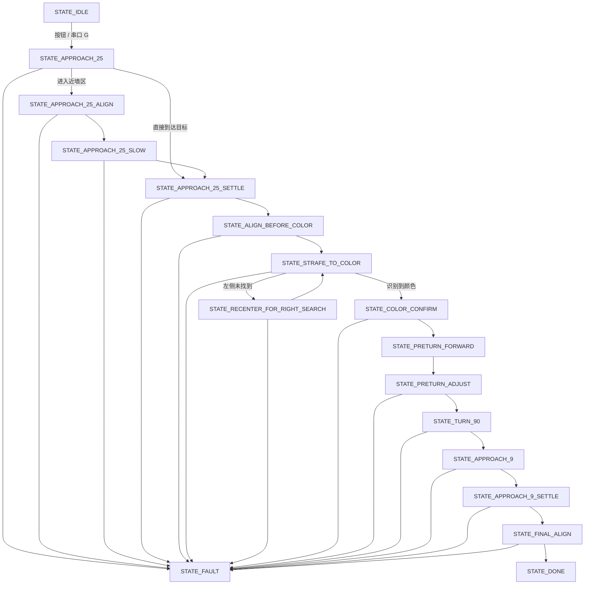

# final_code README

## 1. 文件作用

[final_code.ino](/F:/李仁杰/香港大学/2025-2026/ELEC3848/Group%20project/firmware/arduino/required_function_c1/final_code/final_code.ino) 是当前 `Required Function C1` 的主程序集成版本。

这个版本把下面几类功能放进了同一个状态机里：

- 电机控制
- 双超声波测距
- 颜色识别
- MPU6050 航向控制
- OLED 显示
- 串口遥测与调试
- 按钮启动

整体流程是：

1. 小车前进到第一段目标距离
2. 用左右两个超声波把车身摆正
3. 横向寻找颜色区域
4. 识别红色或绿色
5. 根据颜色执行 90 度转向
6. 再前进到第二段目标距离
7. 最后再次对齐并停车

如果超声波、陀螺仪或颜色搜索过程出现异常，程序会进入 `STATE_FAULT` 并停车。

## 2. 硬件与引脚

### 电机

- `PWMA = 12`
- `DIRA1 = 34`
- `DIRA2 = 35`
- `PWMB = 8`
- `DIRB1 = 37`
- `DIRB2 = 36`
- `PWMC = 9`
- `DIRC1 = 43`
- `DIRC2 = 42`
- `PWMD = 5`
- `DIRD1 = A4`
- `DIRD2 = A5`

### 双超声波

- 右侧 `ultrasonic1`
  - `TRIG = 6`
  - `ECHO = 4`
- 左侧 `ultrasonic2`
  - `TRIG = 10`
  - `ECHO = 7`

### 启动按钮

- `START_BUTTON_PIN = 33`
- 使用 `INPUT_PULLUP`
- 按下时读取为 `LOW`

### 颜色传感器 GY-31

- `OUT = 46`
- `S0 = 44`
- `S1 = 45`
- `S2 = 13`
- `S3 = 11`
- `LED = 47`

### 陀螺仪 MPU6050

- I2C 地址：`0x68`

### OLED

- `SSD1306`
- I2C 地址：`0x3C`
- `OLED_RESET = 28`

## 3. 状态机说明

程序核心是 `RoutineState` 状态机，当前代码里实际使用的状态如下：

- `STATE_IDLE`
  - 待机，等待按钮或串口命令启动
- `STATE_APPROACH_25`
  - 第一阶段快速前进，直到进入近墙控制区
- `STATE_APPROACH_25_ALIGN`
  - 第一阶段近墙前，先用双超声波把车身摆正
- `STATE_APPROACH_25_SLOW`
  - 第一阶段减速靠墙
- `STATE_APPROACH_25_SETTLE`
  - 到达第一段目标距离后短暂停车，并做前后微调
- `STATE_ALIGN_BEFORE_COLOR`
  - 开始找颜色前，再做一次左右对齐
- `STATE_STRAFE_TO_COLOR`
  - 横向移动搜索颜色，先向左找，再视情况切换到向右找
- `STATE_RECENTER_FOR_RIGHT_SEARCH`
  - 左侧没找到颜色后，回正姿态和距离，再准备向右搜索
- `STATE_COLOR_CONFIRM`
  - 对红色/绿色识别结果做短时间确认
- `STATE_PRETURN_FORWARD`
  - 转弯前先小幅前进一段固定时间
- `STATE_PRETURN_ADJUST`
  - 转弯前最后一次修正距离和车身朝向
- `STATE_TURN_90`
  - 根据颜色执行 90 度转向
- `STATE_APPROACH_9`
  - 转向后朝第二段目标距离前进
- `STATE_APPROACH_9_SETTLE`
  - 到达第二段目标距离后做前后微调
- `STATE_FINAL_ALIGN`
  - 最终停车前的最后一次平行修正
- `STATE_DONE`
  - 流程完成，小车停止
- `STATE_FAULT`
  - 故障状态，小车停止并等待重启

## 4. State 流程图

## 5. 颜色与转向关系

颜色识别只关注：

- `RED`
- `GREEN`
- `UNKNOWN`
- `NO_SIGNAL`

确认颜色后，程序会这样决定转向：

- `GREEN` -> 左转 `90°`
- `RED` -> 右转 `90°`

颜色不是单次读数立刻决定的，而是通过多次采样和计数确认后再进入转向。

## 6. 超声波逻辑

两个超声波主要用于两件事：

- 计算平均距离
  - 判断是否接近墙面
  - 判断是否达到目标停车距离
- 计算左右差值
  - 判断车身是否歪斜
  - 决定是否需要左修正或右修正

当前流程中有两次靠墙目标：

- 第一段目标距离：`27.0 cm`
- 第二段目标距离：`9.0 cm`

如果左右差值超过容差，程序会优先做旋转修正，再继续前进。

## 7. OLED 与串口输出

### OLED 显示内容

OLED 会显示：

- 当前状态缩写
- 当前颜色结果
- 右侧距离 `R`
- 左侧距离 `L`
- 平均距离 `A`
- 左右差值 `D`
- 当前航向角 `H`

进入 `STATE_FAULT` 时，OLED 会优先显示 `FAULT` 和故障信息。

### 串口输出内容

串口会周期性输出：

- 当前时间 `ms`
- 当前状态
- 左右超声波距离
- 平均距离
- 左右差值
- 当前航向角
- 当前陀螺仪 Z 轴角速度
- 原始颜色识别结果
- 稳定颜色结果
- 故障信息（如果存在）

## 8. 启动与调试命令

### 按钮启动

- 按下 `pin 33` 上的按钮后启动完整流程

### 串口命令

- `G`
  - 启动流程
- `X`
  - 停止并回到 `STATE_IDLE`
- `C`
  - 重新校准陀螺仪零偏，并回到 `STATE_IDLE`

## 9. 当前关键参数

当前代码中的主要控制参数如下：

- 第一段目标距离：`27.0 cm`
- 第一段进入近墙区：`65.0 cm`
- 第一段减速起点：`42.0 cm`
- 第一段爬行起点：`31.0 cm`
- 第一段恢复范围：`25.5 ~ 28.5 cm`

- 第二段目标距离：`9.0 cm`
- 第二段减速起点：`20.0 cm`
- 第二段爬行起点：`12.0 cm`
- 第二段恢复范围：`8.0 ~ 10.0 cm`
- 最终硬停车保护距离：`6.0 cm`

- 第一阶段对齐容差：`1.4 cm`
- 最终对齐容差：`1.0 cm`

- 转角目标：`90°`
- 转角容差：`2.2°`
- 直行航向保持容差：`3.0°`

## 10. 代码结构

从结构上看，这个文件主要分成这些部分：

- 硬件初始化
  - 电机
  - 双超声波
  - 按钮
  - 颜色传感器
  - OLED
  - MPU6050
- 数据更新
  - `updateHeading()`
  - `updateDistanceSnapshot()`
  - `updateColorSnapshot()`
- 状态执行
  - `runStateMachine()`
  - 各个 `run...()` 状态函数
- 输出与调试
  - `updateOled()`
  - `printTelemetry()`
  - `handleCommand()`

## 11. 使用建议

- 每次测试前先让小车静止，确保陀螺仪校准完成
- 先单独确认左右超声波读数稳定，再跑整套流程
- 如果颜色识别不稳，优先检查光照、传感器高度和横移速度
- 如果 90 度转向不准，优先检查陀螺仪零偏和 `TURN_TOLERANCE_DEG`
- 如果第一段或第二段靠墙总有固定偏差，优先检查左右轮功率平衡和超声波安装对称性
- 如果进入 `STATE_FAULT`，先看串口输出中的故障原因，再判断是传感器问题还是参数问题
